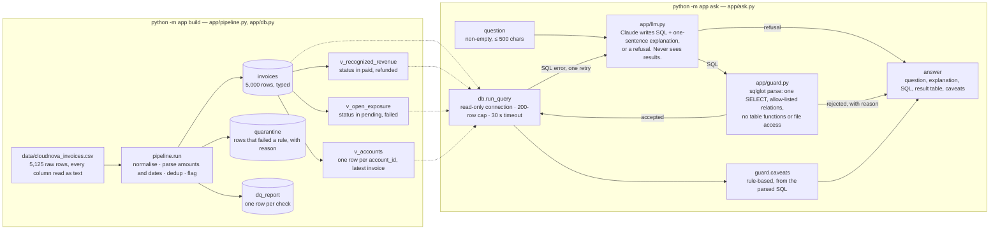

# CloudNova revenue Q&A

## What it does

It turns CloudNova's dirty invoice export (5,125 rows from three source systems) into a clean,
typed DuckDB database, with every cleaning rule written down and every row that breaks a rule
set aside with a reason instead of guessed at. It then answers finance questions in plain
English: Claude writes one SQL query, a guard checks it, the query runs read-only, and the SQL
is shown next to the result so every number can be audited. An eval suite checks the numbers
against an independent calculation and keeps one known-wrong answer visible rather than hiding it.

## How to run it

```
python -m venv .venv
.venv\Scripts\activate          # Windows;  source .venv/bin/activate on macOS/Linux
pip install -r requirements.txt
copy .env.example .env          # then put your Anthropic key in .env
python -m app                   # the demo: builds the database, answers the six questions
```

| Command | Needs an API key? | Does |
|---|---|---|
| `python -m app` | yes | The demo. Builds the database if missing, answers the six stakeholder questions |
| `python -m app ask "question"` | yes | One question. Add `--json` for machine-readable output |
| `python -m app build` | no | Runs the cleaning pipeline and prints the data-quality report |
| `python -m evals` | no | Pipeline and guard evals. Rebuilds the database first |
| `python -m evals --nl` | yes | Adds the question-layer evals and the expected-fail case |

`ask` and the demo call the Anthropic API and stop with a one-line message if
`ANTHROPIC_API_KEY` is missing. `build` and `python -m evals` never call the API, which is what
CI runs. A captured demo run is in [docs/sample-run.txt](docs/sample-run.txt).

## Architecture



The same diagram with a box-to-code table is in [docs/architecture.md](docs/architecture.md).

## The six answers

All six come from the demo run in [docs/sample-run.txt](docs/sample-run.txt) and match the
expected values in [specs/evals.md](specs/evals.md). "Revenue" is net: paid invoices plus
refunds, with refunds negative.

| # | Question | Answer |
|---|---|---|
| 1 | Total recognized revenue in USD for paid invoices in 2024 | Net **$30,755,088.25** (paid $32,686,371.05, refunds −$1,931,282.80) |
| 2 | Region with the highest average MRR per account | **APAC, $6,272.22** per active account (510 accounts). Then NA $6,117.20, EMEA $5,576.38, LATAM $5,333.81 |
| 3 | Total given back in refunds | **$8,925,163.77** across **292** refunded invoices |
| 4 | Churn rate, Enterprise vs Starter | Enterprise **21.92%** (171 of 780 accounts), Starter **18.81%** (354 of 1,882) |
| 5 | Top 5 accounts by revenue, flag CSAT ≤ 2 | ACC-7509 Stark Inc $1,210,592.75; ACC-1420 Tyrell Industries $1,208,092.75; ACC-9946 Initech LLC $1,205,642.75; ACC-1196 Pied Piper Partners $1,107,352.84; ACC-5211 Oscorp Industries $1,085,078.48. **None flagged** on current CSAT; see limitations |
| 6 | Invoices stuck in pending/failed and exposed $ | **894 invoices, $28,983,255.81** (pending 498 / $15,825,603.53; failed 396 / $13,157,652.28) |

Two of these carry a caveat that changes how far to trust them. Answer 1 and every other
dollar figure depend on the FX rule (below): under the alternative reading, 2024 net revenue is
$27,823,962.37. Answers 2, 4 and 5 are per-account and depend on an account key that is not
stable in this export.

## Specs

The specs were written before any code and are the source of truth. If code and spec disagree,
the code is wrong.

- [specs/schema.md](specs/schema.md): cleaned schema, normalisation, dedup, FX, MRR, accounts
- [specs/query_contract.md](specs/query_contract.md): CLI, question flow, SQL guard, caveats
- [specs/evals.md](specs/evals.md): eval cases and expected values
- [data/BUSINESS_CONTEXT.md](data/BUSINESS_CONTEXT.md): the customer briefing the specs came from
- [docs/data-profile.md](docs/data-profile.md): the raw-data profile every decision traces to

## Design decisions and trade-offs

- **The model writes SQL, never numbers.** Claude sees the schema, a business glossary and the
  question, and returns SQL plus a one-sentence explanation. It never sees the result, so it
  cannot misquote it. The cost is that a question the ledger cannot answer gets a refusal, not a
  helpful guess.
- **Views are the semantic layer.** Revenue, open exposure and "one row per account" are defined
  once in DuckDB views; the model is told to use them. Business rules are not re-derived per
  question.
- **FX as briefed, flagged loudly.** The briefing says USD = local × rate. The data shows the
  local amounts already equal USD list price × rate, so multiplying again inflates non-USD
  revenue by about $2.9M in 2024. The customer's stated rule wins and the discrepancy is an open
  question for finance, not something fixed silently in code.
- **Exact money, rounded once.** `amount_usd` is stored as the exact product at four decimals
  and rounded to two only in the final SELECT. Rounding per row would have broken the evals by a
  cent on tie cases such as £28,003.50 × 1.27.
- **Dedup by lifecycle.** Exact duplicates go first. For the 16 invoice IDs where source
  systems disagree on status, the more final state wins (refunded > void > paid > failed >
  pending). File order carries no signal, so this is an assumption; it moves all-time revenue
  by under $170K either way.
- **Dates by separator.** Slash dates are month-first, dash dates day-first. The data supports
  it (no slash date has a first part above 12, 313 dash dates have one), but it is an inference
  that affects the month of 81 invoices.
- **`account_id` is the key, attributes from the latest invoice.** The data dictionary says
  `account_id` is the account, so it is used, even though it behaves like a per-invoice ID.
- **Quarantine, never coerce.** Any value that fails a rule sends the whole row to `quarantine`
  with a reason. On this file that is 0 rows, and the evals assert it.
- **Three lines of defence on SQL.** A parser-based guard (one SELECT, four allowed relations,
  no table functions), then a read-only connection, then a 200-row cap and 30-second timeout.
- **An independent oracle.** Expected values were computed by a separate pandas script before
  the pipeline existed. The pipeline never imports it, so a passing eval means two
  implementations of the spec agree.
- **No frameworks.** pandas, DuckDB, sqlglot, the Anthropic SDK and a `.env` file. No web UI,
  server, vector store, cache or Docker; see next steps.

## Known limitations and failure modes

Data (from [docs/data-profile.md](docs/data-profile.md)):

- **FX may be applied twice.** 39.6% of all-time revenue is non-USD. The two readings differ by
  $2.9M on 2024 net revenue. Every answer that uses `amount_usd` carries this caveat.
- **`account_id` is not a stable key.** 976 of the 980 multi-invoice IDs carry more than one
  account name, and most change region and signup date. Per-account answers (MRR by region,
  churn, top accounts, CSAT) are only as good as this key. This is what the expected-fail case
  X1 shows: asked which top-5 account ever reported CSAT ≤ 2, finance would expect ACC-1196
  (one invoice under that ID has CSAT 2), but the system reads CSAT from the latest invoice
  (CSAT 3) and flags nothing. The two invoices under that ID have different account names, so
  neither answer is trustworthy until CloudNova fixes the key. The harness reports it as XFAIL.
- **81 invoices have inferred day/month order**, affecting monthly and quarterly figures but no
  annual one.
- **16 invoices had conflicting statuses** across source systems; a lifecycle rule decided.
- **Future-dated invoices are included.** Invoice dates run to July 2027; 108 rows were in the
  future on the run date. All-time totals include them and the rows are flagged.

Question layer (from the caveats table in [specs/query_contract.md](specs/query_contract.md)
and the spec review):

- **The date caveat misses range filters.** The "inferred day/month" caveat fires on month and
  quarter functions, but a month written as `invoice_date BETWEEN '2024-01-01' AND
  '2024-01-31'` gets no caveat. A date predicate inside a JOIN condition is also not counted as
  a date filter, so the status-conflict caveat can appear when it should not.
- **Question-layer evals vary with model output.** Tiers 2 and 3b send the question to Claude,
  and the SQL it writes can differ between runs. Grading checks that the expected numbers appear
  in the result, not that the SQL matches, so a pass is evidence rather than proof. Tier 1
  (canonical SQL, no model) is the deterministic check.
- **The row cap and timeout have no eval case.** Both were exercised by hand (a full-table
  select truncates at 200 rows; a cross join is cancelled), but nothing in `python -m evals`
  would catch them breaking.
- **Amounts print without two-decimal formatting.** The result table shows what the query
  returns, so a refund total of −1,931,282.80 prints as `-1931282.8`. Correct, but not
  finance-formatted.
- **The explanation is model text.** It is written before execution and the prompt forbids
  numbers in it, but nothing in code checks that. Numbers in the result table always come from
  the query.
- **One question at a time.** No conversation, no charts, no forecasting, no write access.

## How AI was used

The specs came first and by hand. The first two commits are the raw data, the profile and the
three specs; no code existed yet. Claude Code (Claude Fable 5.1) then built the project from the
specs in six steps, one commit each, following [docs/build-plan.md](docs/build-plan.md). Each
step began with a plan and a list of places where the spec was ambiguous, silent or
contradictory, and those were resolved by changing the spec in its own commit before any code.
Three gaps found that way: the rounding rule for `amount_usd` (which would have failed the
evals on tie cases), the caveat trigger that could not be evaluated as written, and the parsing
rules for the typed columns the spec had not covered.

The eval oracle was written separately and the AI was told not to read it while building the
pipeline. After the question layer was built, a spec-reviewer subagent with no stake in the code
checked every spec section and probed the guard with 196 adversarial queries; its three findings
were fixed in their own commit and the lesser ones are listed above. The question layer itself
uses Claude Sonnet 5.5 through the Anthropic API with structured output, and the model ID is
configuration, not code. Where judgement calls were made (what Tier 2 must find in a result,
whether to keep an extra field), the human decided and the spec was updated to match.

## Next steps with another day

- As-of FX rates instead of fixed ones, and a decision from finance on whether local amounts are
  already converted.
- Entity resolution for accounts once a reliable key exists, which would retire X1.
- Two-decimal money formatting in the result table, and a date-range rule for the caveat.
- Eval cases for the row cap and the timeout, and a scheduled CI job that runs `--nl` with a
  secret so question-layer drift is noticed.
- A reviewed library of approved queries for the questions finance asks most, so those never
  depend on the model.
- Hybrid routing: SQL for aggregates, retrieval over rows for lookup questions.
- Query result caching and per-question cost and latency logging.
