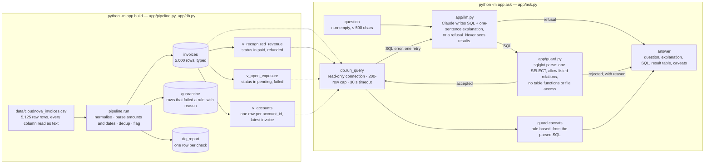

# Architecture

One diagram, matching the code. Left: the build (`python -m app build`). Right: one question
(`python -m app ask` and the demo). The views are the only thing the question layer may query.

Where each box lives:

| Box | Code |
|---|---|
| pipeline.run | `app/pipeline.py` `read_raw`, `clean_row`, `parse_amount`, `parse_date`, `run` |
| tables and views | `app/db.py` `write_database`, `view_ddl` |
| Claude writes SQL | `app/llm.py` `system_prompt`, `glossary`, `generate_sql` |
| guard | `app/guard.py` `check_sql` |
| run_query | `app/db.py` `run_query` |
| caveats | `app/guard.py` `caveats` |
| answer | `app/ask.py` `answer`, `render`, `to_json` |
| constants | `app/config.py` (paths, FX, list prices, mappings, model, limits, caveat text) |

Evals (`python -m evals`) rebuild the database, run the data-quality checks and the canonical SQL
for each question against it, and probe the guard. `--nl` adds the same questions through the
model and the expected-fail case X1.
